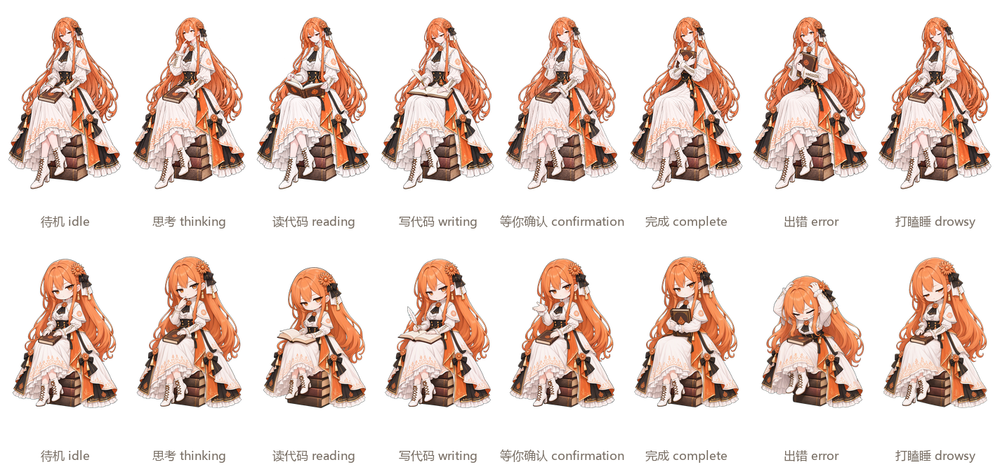

<div align="center">


# Claude-Chan

**陪你写代码的桌面小伙伴。**
Claude Code 在思考、读代码、写代码、等你确认、做完了、出错了——她都会跟着动起来。

[下载](https://github.com/Ivanfangsc/claude-chan/releases/latest) · [安装](#安装) · [常见问题](#常见问题) · [开发文档](docs/development.md)

</div>

---

## 她能做什么

- **跟着 Claude Code 的状态动**：你提问时她托腮思考，Claude 读文件时她低头看书，改代码时她提笔写字，需要你批准时她举手示意，任务完成时她把书抱在胸前。
- **不只是换张图**：每两个状态之间都有专门的过渡动画；待机时一直轻轻摇晃，看不出“又从头开始了”；偶尔还会喝口茶、扶一下发饰、望望远方。
- **后台任务也看得见**：Claude 在后台跑命令或子代理时，她会时不时掏出怀表看一眼，等任务真正结束才收起来。
- **多个会话一起看**：同时开好几个 Claude Code（Windows、WSL、桌面版都行），她显示最需要你注意的那个；等你确认时，头顶的气泡会写着是哪个项目。
- **两种形象**：原版，和冷脸萌的三头身 Q 版（出错时会抱头蹲防）。托盘里一键切换。
- **不挡你干活**：透明的地方鼠标直接点穿；打游戏、看视频全屏时自己躲起来；可以贴在 Claude 桌面版窗口的一角跟着走。

<div align="center">

</div>

| 状态 | 什么时候 | 她在做什么 |
|---|---|---|
| 待机 | 没有任务 | 坐在书堆上轻轻摇晃 |
| 思考 | 你刚提交问题，或 Claude 在想 | 指尖抵着下巴 |
| 读代码 | Claude 在读文件、搜索 | 低头看书 |
| 写代码 | Claude 在改文件、运行命令 | 用羽毛笔写字 |
| 等你确认 | Claude 需要你批准或回答 | 举手示意，头顶显示项目名 |
| 完成 | 任务做完 | 把书抱在胸前，30 秒后回到待机 |
| 出错 | 工具调用失败 | 吓一跳（Q 版：抱头蹲防） |
| 等后台任务 | Claude 在等后台命令跑完 | 待机，时不时看一眼怀表 |
| 打瞌睡 | 10 分钟没有任何动静 | 闭眼打盹，偶尔冒个 Zzz |

## 安装

目前只在 **Windows 10 / 11** 上测试过。需要已经装好 [Claude Code](https://code.claude.com/docs)（命令行或桌面版都可以）。

### 1. 运行桌宠

1. 到 [Releases](https://github.com/Ivanfangsc/claude-chan/releases/latest) 下载最新的 `ClaudeChan-<版本>-windows.zip`。
2. 解压到一个固定的位置，比如 `%LOCALAPPDATA%\Programs\ClaudeChan`（以后开机自启会用这个路径，不要放在“下载”里随手删掉）。
3. 双击里面的 `ClaudeChan.exe`。她会出现在屏幕右下角，托盘里也会多一个图标。

> 第一次运行时 Windows 可能弹出“Windows 已保护你的电脑”：程序没有付费的代码签名。点 **更多信息 → 仍要运行** 即可。

### 2. 安装 Claude Code 插件

在 PowerShell 里运行：

```powershell
claude plugin marketplace add Ivanfangsc/claude-chan
claude plugin install claude-chan@claude-chan
```

命令行版和桌面版共用同一份配置，装一次两边都生效。装好后随便问 Claude 一个问题，她就会开始动。

### 3. 开机自启（推荐）

右键她（或右键托盘图标），勾选 **开机自启**。

建议让她一直开着：桌宠没开时，Claude Code 每次调用工具会多等不到半秒（插件找不到她，等一下就放弃，不会报错）。

### WSL 里使用

WSL 里的 Claude Code 也能连上，需要让 WSL 和 Windows 共用网络。在 `%USERPROFILE%\.wslconfig` 里写：

```ini
[wsl2]
networkingMode=mirrored
```

在 PowerShell 里运行 `wsl --shutdown`，重新打开 WSL，然后在 WSL 里同样执行上面两条 `claude plugin` 命令。

## 使用

| 操作 | 效果 |
|---|---|
| 左键拖动 | 移动她 |
| Ctrl + 滚轮 | 放大缩小 |
| 右键 | 打开菜单 |
| 双击 | 打开调试面板（看她收到了什么事件） |

菜单里可以：

- **显示 / 隐藏**：左键单击托盘图标也可以。
- **置顶**：默认开启，总在其他窗口上面。
- **鼠标穿透**：完全不接收鼠标，只能从托盘菜单关掉。
- **跟随 Claude 窗口**：贴在 Claude 桌面版窗口的右下角，窗口移动时跟着走、最小化时一起藏起来。把她拖到窗口里别的位置，会记住那个位置。没开 Claude 桌面版时，她回到桌面上原来的地方。
- **形象**：原版 / Q 版，点了立即切换。
- **重置位置和大小**、**开机自启**、**退出**。

关掉窗口（Alt + F4）只是藏到托盘里，要彻底退出请用菜单里的 **退出**。

## 设置

大部分人不需要改设置。想调整的话，菜单里点 **打开配置文件夹**，新建或编辑 `config.json`，只写想改的项，改完点 **重新加载配置**。

例：让她 3 分钟没动静就打瞌睡，并关掉随机小动作：

```json
{
  "state": { "timing": { "idleToDrowsyMs": 180000 } },
  "animation": { "eventChance": 0 }
}
```

常用的几项：

| 设置 | 默认 | 说明 |
|---|---|---|
| `state.timing.idleToDrowsyMs` | `600000`（10 分钟） | 多久没动静开始打瞌睡 |
| `state.timing.completeHoldMs` | `30000`（30 秒） | 完成后保持多久再回到待机 |
| `animation.eventChance` | `0.25` | 随机小动作出现的频率，`0` 关闭 |
| `window.hideInFullscreen` | `true` | 有全屏窗口时自动隐藏 |
| `window.followProcesses` | `["claude.exe"]` | “跟随窗口”要贴的程序，想贴终端可以加 `"windowsterminal.exe"` |

全部设置见[开发文档的配置项](docs/development.md#配置项)。

## 常见问题

**她一直不动？**
先双击她打开调试面板，然后问 Claude 一个问题，看“会话”表里有没有出现新会话。没有的话：

- 确认插件已安装：运行 `claude plugin list`，`claude-chan@claude-chan` 应该是 enabled；
- Claude 桌面版里，输入框的 **+ → Plugins** 应该能看到它（只对本地会话生效，云端会话不加载本地插件）；
- 如果你在 Claude Code 的设置里配置过 `allowedHttpHookUrls`，需要把 `http://127.0.0.1:47800/event` 加进去。

**会拖慢 Claude Code 吗？**
她开着的时候，每个事件几毫秒就处理完。没开时，每次工具调用最多多等约 0.4 秒。

**占多少资源？**
内存约 100 MB。播放动画时大约占一个 CPU 核心的四分之一；被隐藏、全屏让开时停止解码，几乎不占 CPU。

**会联网或上传什么吗？**
不会。她只在本机 `127.0.0.1:47800` 接收 Claude Code 发来的事件，不连接任何外部服务器。

**怎么卸载？**

```powershell
claude plugin uninstall claude-chan@claude-chan
claude plugin marketplace remove claude-chan
```

再在菜单里取消开机自启、退出，删掉解压出来的文件夹即可。设置保存在 `%APPDATA%\claude-girl`，也可以一并删掉。

**以前装过 claude-girl？**
这是改名前的版本。先卸载旧插件（`claude plugin uninstall claude-girl@claude-girl`、`claude plugin marketplace remove claude-girl`），再按上面安装，不然两个插件会各发一遍事件。原来的设置会继续生效。

## 她是怎么做出来的

所有动画都是在本机用开源模型生成的：Qwen Image 2.1 从一张立绘编辑出各个状态，MiniMax H3 生成视频，再自动抠图、拼接成看不出循环的 loop。为什么普通的“首尾同一帧”循环会有循环感、我们是怎么解决的，写在 [docs/animation-pipeline.md](docs/animation-pipeline.md)。

想从源码运行、换素材或者参与开发，见 [docs/development.md](docs/development.md)。

## 致谢

- **人设**：B 站 UP 主 [ZipZipPipe](https://www.bilibili.com/opus/1233069202138464289) 的《所有的AI们，和OpenCode》。Claude-Chan 是在这份人设的基础上二次创作的，角色设计的权利归原作者所有。
- **模型**：[Qwen Image 2.1](https://huggingface.co/Qwen/Qwen-Image-2.1)（关键帧编辑），[MiniMax H3](https://huggingface.co/MiniMaxAI/MiniMax-H3)（动画生成），运行在 [ComfyUI](https://github.com/comfyanonymous/ComfyUI) 上。
- **参考**：[dsh-pet](https://github.com/PC2005-cloud/dsh-pet)（“道具从无到有再到无”的写法），[GPT-Niang](https://github.com/T7moris/GPT-Niang)（跟随主窗口的做法）。

## 许可

- **代码和文档**：[MIT](LICENSE)。
- **角色素材**（关键帧、动画、图标）：本项目自己做的部分以 [CC BY 4.0](ASSETS-LICENSE.md) 授权；原人设的权利归 ZipZipPipe，详见 [ASSETS-LICENSE.md](ASSETS-LICENSE.md)。
- 素材全部由 AI 生成，再经人工挑选和后期处理。
- “Claude” 是 Anthropic, PBC 的商标。本项目是**非官方的同人作品**，与 Anthropic 没有关联，也未经其认可。
